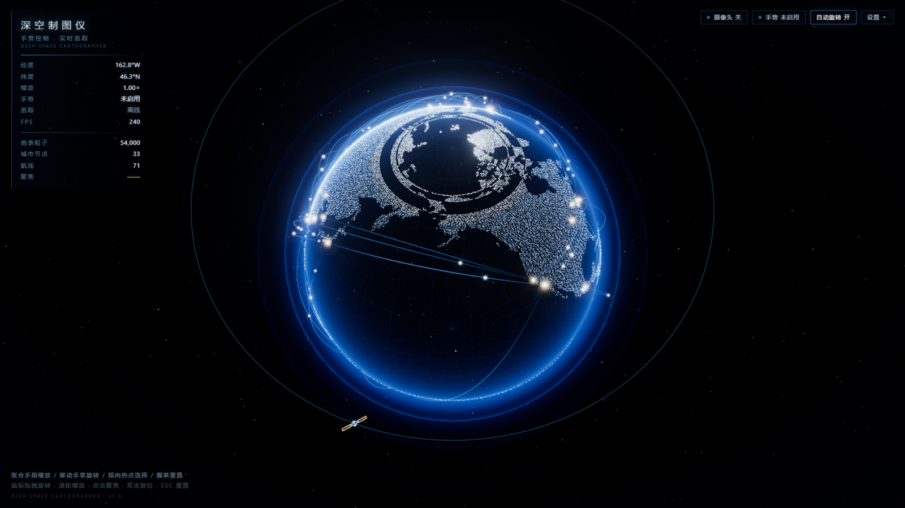

# 深空制图仪 · 手势控制的深空地球仪

一个全屏、电影感、深空作战指挥界面风格的 3D 地球数据可视化网页。
大陆由数万颗蓝白发光粒子组成，海洋为透明深蓝球体，城市之间流转着弧形数据航线。
支持 **摄像头手势控制**（MediaPipe HandLandmarker），并在拒绝摄像头时完整降级为 **鼠标 / 触控** 操作。

   

▶ **在线体验**：[yanx5433-cmd.github.io/deep-space-globe](https://yanx5433-cmd.github.io/deep-space-globe/)（建议全屏；手势控制需允许摄像头）



---

## 快速启动

```bash
npm install
npm run dev        # 打开 http://localhost:5173
```

生产构建与预览：

```bash
npm run build
npm run preview    # 注意：构建产物按 GitHub Pages 子路径生成，预览地址为 http://localhost:4173/deep-space-globe/
```

> 无任何付费 API、无需 API Key。陆地数据与手势模型均已本地打包，运行时不请求地图数据。

---

## 操作方式

### 手势控制（点击「启用手势控制」并允许摄像头后）

| 手势 | 动作 |
| --- | --- |
| **移动手掌**（张开手掌滑动） | 旋转地球（水平=经度，垂直=纬度，带死区/限速/低通滤波/惯性） |
| **手掌推近 / 拉远** | 连续放大 / 缩小（手掌在画面中变大=拉近，变小=拉远） |
| **拇指+食指捏合** | 精确连续缩放（捏合标定，不跳变） |
| **食指指向** | 屏幕出现准星，指向城市热点停留约 500ms 选中，摄像机平滑飞向该城市 |
| **握拳** | 持续缩小（拉远）；**保持 2 秒**重置为全球视角、清除选中、恢复自动旋转 |
| **手离开画面** | 状态保持不乱跳，约 2.4 秒后自动旋转缓缓恢复 |

手势引擎内置：最近 7 帧投票、EMA 平滑、手势切换 260ms 冷却、手掌尺寸置信度阈值、丢帧保护、推理节流 ~30 FPS。

### 鼠标 / 触控（拒绝摄像头时自动启用，功能完整）

| 操作 | 动作 |
| --- | --- |
| 左键拖拽 | 旋转地球（带惯性） |
| 滚轮 | 缩放 |
| 点击城市光点 | 聚焦该城市 |
| 双击空白处 / ESC | 重置全球视角 |
| 单指触控 | 旋转 |
| 双指捏合 | 缩放 |

### 界面开关（右上角）

- **自动旋转 开/关**
- **设置 ▾**：显示调试画面（右下角镜像摄像头 + 21 关键点叠加）、环境音效（默认关闭）、重新启用手势控制
- 底部左侧有常驻操作提示

---

## 摄像头与隐私说明

- 摄像头画面**只在本地浏览器内**交由 MediaPipe（WebAssembly）处理，**不会上传任何数据**。
- 浏览器要求 `getUserMedia` 运行在**安全上下文**：`http://localhost` 即可，局域网 IP 调试需 HTTPS。
- 摄像头权限被拒绝 / 没有摄像头 / 被占用 / 模型加载失败时，会显示友好中文提示并**自动切换鼠标模式**，所有功能依然可用。

---

## 视觉与工程要点

- **星空**：三层不同半径星壳，各自缓慢漂移 + 逐星闪烁 + 冰蓝/暖白配色。
- **大陆**：由 `world-atlas`（Natural Earth 110m）离线栅格化出的 0.5° 陆地掩码生成 **54,000 颗粒子**（`prefers-reduced-motion` 时减半）；掩码解码失败时回退为程序化备用点云，永不白屏。
- **地球**：透明深蓝海洋球（Fresnel 边缘光）+ 极淡经纬网格 + 三层淡蓝色大气辉光外壳。
- **城市**：33 个主要城市（上海、东京、新加坡、纽约、伦敦、巴黎、迪拜、悉尼、伊斯坦布尔、洛杉矶等），暖金发光点，呼吸动画、光晕、向外扩散波纹；选中后金色脉冲环 + 扩散波纹。
- **航线**：71 条弧形数据线，端点暗、中段亮；选中城市后相关航线 0.8s 内依次点亮为金色，无关航线减淡；航线上有按占空比出现/扫过的数据包光点。
- **卫星**：半透明线框卫星 + 倾斜轨道线，缓慢绕行。
- **后期**：UnrealBloom（阈值 0.82、强度 0.42，克制不过曝），HalfFloat + MSAA 渲染目标。
- **动效**：所有旋转/缩放/飞行均走阻尼 + 惯性 + easeInOutCubic；城市飞行约 1.25s；字幕为「淡入上浮 → 停留 → 淡出」的电影字幕。
- **性能**：`requestAnimationFrame` 单循环；几何体/材质/曲线全部一次创建复用；DPR 上限 2；窗口变化自动更新相机与渲染器。

## 目录结构

```
├── scripts/generate-land-mask.mjs   # 陆地掩码生成脚本（可选运行）
├── public/
│   ├── mediapipe/wasm/              # MediaPipe wasm（本地化，失败时回退 CDN）
│   └── models/hand_landmarker.task  # 手部关键点模型（本地化，失败时回退 CDN）
└── src/
    ├── data/          # cities.ts 城市经纬度 / routes.ts 航线 / landMask.ts 陆地掩码
    ├── lib/           # geo 坐标转换 / mathf 缓动 / landParticles 粒子构建 / audio 合成音效
    ├── state/         # store（zustand UI 状态）/ controls（旋转缩放核心）/ telemetry / uiRegistry
    ├── scene/         # Scene 主循环 / StarField / OceanSphere+Graticule+Atmosphere /
    │                  # ContinentParticles / CityNodes / RouteArcs / Satellite / Effects(Bloom)
    ├── gestures/      # GestureEngine（MediaPipe 生命周期+输入平滑）/ classify（手势分类）
    └── ui/            # HUD / StatusCluster / StartupOverlay / CityCaption / Crosshair /
                       # DebugPanel / Toasts / Hints / pointer（鼠标触控降级）
```

### 重新生成陆地掩码（可选）

```bash
npm run generate:landmask   # 需要 devDependencies 中的 world-atlas
```

### 开发辅助

`/?force-frames=1`（仅 dev 构建生效）：用定时器驱动渲染循环并直接注入画布尺寸，
用于无头/被遮挡环境下的自动化验证；正常使用无需此参数。

## 部署（GitHub Pages）

线上地址：<https://yanx5433-cmd.github.io/deep-space-globe/>（由 `gh-pages` 分支提供，HTTPS，满足摄像头所需的安全上下文）。

更新线上版本：

```bash
npm run build
# 将 dist/ 内容推送到 gh-pages 分支
cd dist && git init -b gh-pages && \
  git add -A && git commit -m "deploy" && \
  git push -f https://github.com/yanx5433-cmd/deep-space-globe.git gh-pages
```

构建时的资源基路径由 `vite.config.ts` 中的 `base` 控制（构建为 `/deep-space-globe/`，开发为 `/`），
MediaPipe wasm 与手势模型路径已通过 `import.meta.env.BASE_URL` 自动适配子路径部署。

## 故障排查

| 现象 | 处理 |
| --- | --- |
| 提示「需要 HTTPS 或 localhost」 | 用 `localhost:5173` 访问，或为局域网域名配置 HTTPS |
| 摄像头被拒绝 | 浏览器地址栏权限图标中重新允许，然后右上角「设置 ▾ → 启用手势控制」 |
| 手势模型加载失败 | 项目已内置本地模型；若 7.8MB 模型缺失会自动回退 Google CDN，需可访问外网 |
| 画面 FPS 低 | 关闭其它标签页；集成显卡可将浏览器硬件加速开启 |
